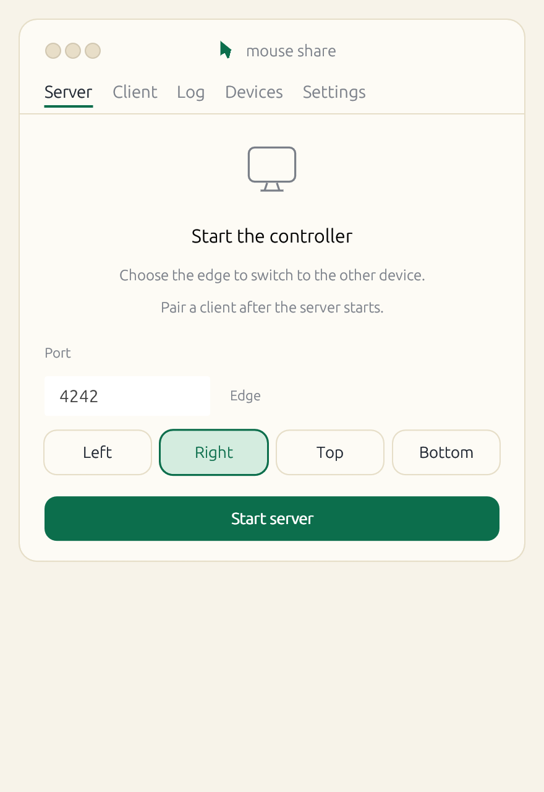
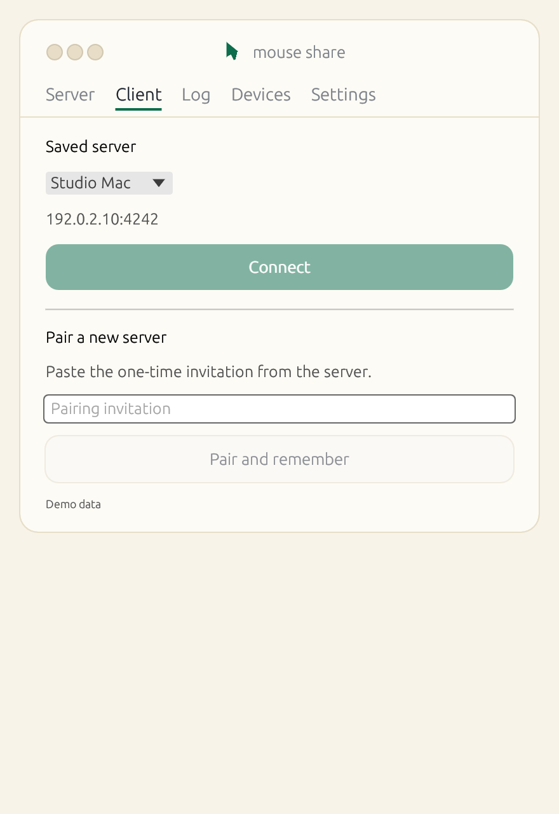
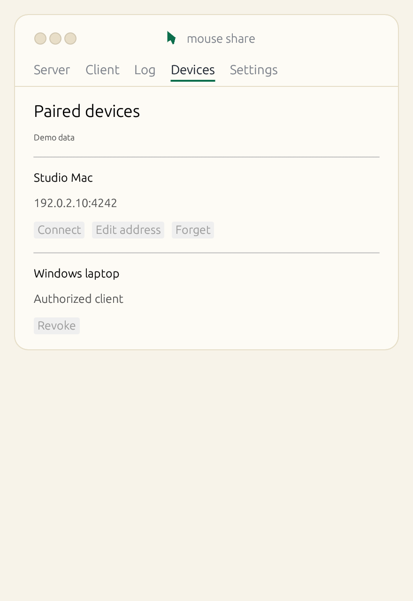

# mouse-share

[简体中文](README.zh-CN.md)

Share one mouse, keyboard, and text clipboard between paired macOS and Windows computers on the same network. Move the pointer across the configured edge of the controller's primary display to take control of the other computer.

**Protocol v2 requires both computers to update together.** The controller uses one UDP port, 4242 by default, for the encrypted QUIC connection.

## GUI

| Controller | Client | Paired devices |
| --- | --- | --- |
|  |  |  |

On macOS, build the app bundle and open it:

```sh
./scripts/build-app.sh
open "dist/mouse share.app"
```

On macOS or Windows, you can also run the GUI from source:

```sh
cargo run --locked --release --features ui --bin mouse-share-ui
```

1. On the computer with the physical mouse, open **Server**, choose an edge, and start the server. Allow inbound UDP on the selected port.
2. Enter the controller's LAN address or hostname, select **Add device**, and copy the invitation. Send it privately to the intended client. The invitation expires after five minutes and works once.
3. On the other computer, open **Client**, paste the invitation, and select **Pair and remember**. Choose the saved server and select **Connect**.
4. Move the pointer through the configured edge. To return, move into the client screen and back through the entry edge.

Use **Devices** to connect again after restarting, change a saved address, forget a server, or revoke a client's authorization. Turn keyboard forwarding or clipboard sync off from the controller while the server is running.

### System permissions

On macOS, grant **Accessibility** to mouse share under **System Settings → Privacy & Security**. Enable **Input Monitoring** if macOS requests it for the controller. For the CLI, grant permission to the terminal or executable identified by macOS. Windows may restrict simulated input into apps running at a higher privilege level.

## CLI

Build with `cargo build --locked --release`. Run the controller and explicitly generate an invitation in an interactive terminal:

```sh
mouse-share server --port 4242 --edge right --invite-for 192.168.1.100
```

Use the controller's actual LAN address for `--invite-for`. On the other computer:

```sh
mouse-share pair
mouse-share devices
mouse-share client --device <saved-server-id>
```

`pair` prompts for the invitation without echoing it. On subsequent starts, run `mouse-share server` and connect using the saved ID. Use `mouse-share address <id> <host:port>` to update an address and `mouse-share revoke <id>` to remove a device. Press Ctrl+C to end a CLI session.

## Desktop settings

- The app saves language, debug logging, the default UDP port, and screen edge. Port and edge changes apply the next time you start sharing.
- Reconnect is enabled by default and uses the saved server address and certificate. Stopping, canceling, or quitting ends retries.
- With the tray enabled, closing the window leaves sharing active. Use the tray to reopen the window, start or stop sharing, or quit.
- Start on login is opt-in. It resumes the last successful role and connection settings. A regular launch opens the window.
- For a CLI run, use `--no-keyboard`, `--no-clipboard`, `--no-reconnect`, or `--debug`.

## Connection and input behavior

- Pairing pins the controller certificate and stores per-device credentials in macOS Keychain or Windows Credential Manager. A certificate change requires pairing again.
- Pointer positions use QUIC datagrams. The reliable control stream carries screen transitions, buttons, keys, and input state. Text clipboard transfers use their own stream on the same connection.
- The controller releases its local input when the connection fails or the client stops responding for five seconds. The client releases simulated keys and buttons on leave or disconnect.
- The controller supports one active client and the primary display. Mouse and text clipboard sharing work across macOS and Windows. Keyboard forwarding requires matching operating systems.

Run the automated checks with `cargo test --locked --all-features --lib --tests`. For connection diagnostics, start the app with `RUST_LOG=debug`.

## License

MIT
