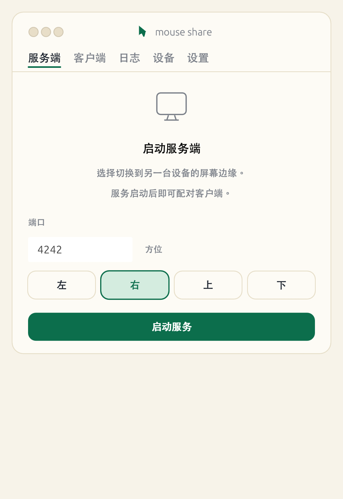
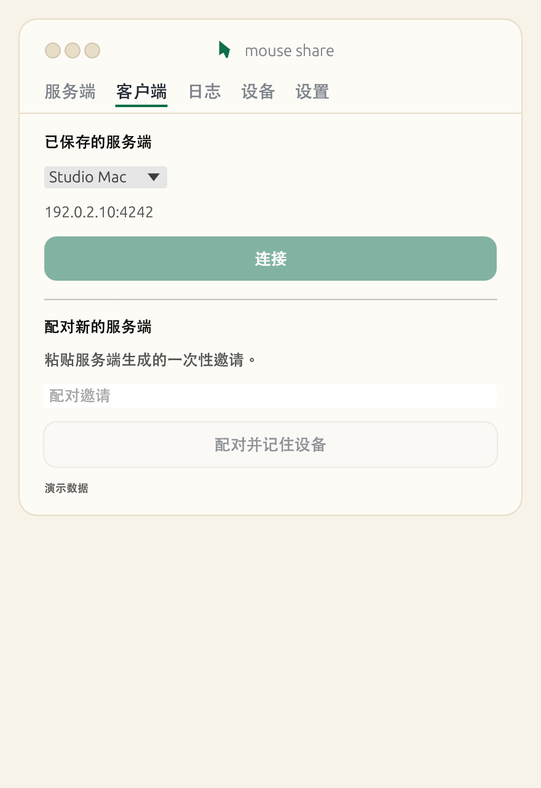
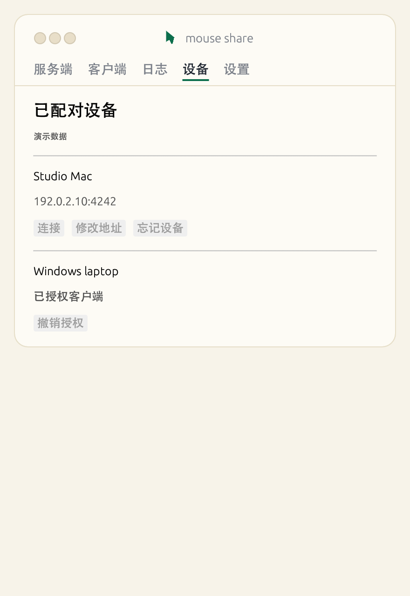

# mouse-share

[English](README.md)

在同一局域网内，让已配对的 macOS 和 Windows 电脑共享鼠标、键盘和文本剪贴板。把光标移过服务端主屏幕上设置的边缘，即可控制另一台电脑。

**协议 v2 要求两端一起升级。** 服务端仅需放行一个 UDP 端口，默认 4242。输入和剪贴板共用加密的 QUIC 连接。

## 图形界面

| 服务端 | 客户端 | 已配对设备 |
| --- | --- | --- |
|  |  |  |

在 macOS 上打包并启动：

```sh
./scripts/build-app.sh
open "dist/mouse share.app"
```

macOS 和 Windows 也可以从源码启动界面：

```sh
cargo run --locked --release --features ui --bin mouse-share-ui
```

1. 在连接物理鼠标的电脑上打开 **服务端**，选择屏幕边缘并启动服务。在防火墙中放行所选 UDP 端口。
2. 输入服务端的局域网地址或主机名，点击 **添加设备**，复制邀请并私下发给要连接的客户端。邀请有效期为 5 分钟，仅可使用一次。
3. 在另一台电脑上打开 **客户端**，粘贴邀请，点击 **配对并记住设备**。从已保存的服务端中选择设备，再点击 **连接**。
4. 将鼠标移过设置的边缘。切回时，先向客户端屏幕内移动一段距离，再从进入的边缘返回。

在 **设备** 页可以重新连接、修改服务端地址、忘记设备或撤销客户端授权。服务运行期间，可以在服务端页面关闭键盘转发或剪贴板同步。

### 系统权限

macOS 在 **系统设置 → 隐私与安全性 → 辅助功能** 中为 mouse share 授权。若系统提示服务端需要 **输入监控**，一并授权。使用 CLI 时，向系统指明的终端或可执行文件授权。Windows 可能限制向权限更高的应用注入输入。

## 命令行

用 `cargo build --locked --release` 构建。在交互终端启动服务端并生成邀请：

```sh
mouse-share server --port 4242 --edge right --invite-for 192.168.1.100
```

将 `--invite-for` 的值替换为服务端的实际局域网地址。在客户端运行：

```sh
mouse-share pair
mouse-share devices
mouse-share client --device <保存的服务端ID>
```

`pair` 交互式读取邀请且不回显。以后只需启动 `mouse-share server`，再用已保存的 ID 连接。`mouse-share address <id> <host:port>` 更新地址，`mouse-share revoke <id>` 移除设备。按 Ctrl+C 结束 CLI 会话。

## 连接与输入行为

- 配对时固定服务端证书，各设备独立的认证凭据保存在 macOS Keychain 或 Windows Credential Manager。证书变更后需要重新配对。
- 光标位置通过 QUIC 数据报传输。切屏、按钮、按键及输入状态使用可靠控制流，文本剪贴板使用同一连接内的独立流。
- 连接断开或客户端连续 5 秒未响应时，服务端恢复本机控制。客户端在退出切屏或断开会话时释放已模拟的键和按钮。
- 支持一个活动客户端和主显示器。鼠标及文本剪贴板可跨 macOS 和 Windows 使用，键盘转发要求两端操作系统相同。

运行 `cargo test --locked --all-features --lib --bins` 执行自动化测试。排查连接问题时，可以使用 `RUST_LOG=debug` 启动应用。

## 许可证

MIT
